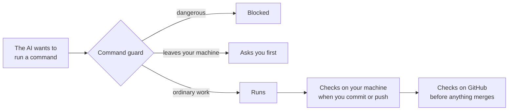

# ai-dev-guardrails

**Seatbelts for coding with an AI assistant.**

An AI coding assistant can run commands on your computer: commit, push, deploy, read files. That is
what makes it useful, and what makes it risky. This kit sets up a project so the common mistakes of
AI-assisted coding are caught automatically, before they cause damage. It catches human mistakes
too.

Built for [Claude Code](https://claude.com/claude-code). Works today for TypeScript projects.
Version 0.1, pre-release: details may change before v1.

---

## See it work

Three things that happen in a project set up with this kit. The messages are the kit's own,
shortened to fit.

**The AI tries to read a secrets file.** Blocked, with the reason shown to the AI:

```text
AI:   cat .env
Kit:  BLOCKED: this would print a secret into the session transcript, which is
      stored and cannot be taken back. To check a value is set, test for presence
      without printing it, e.g. [ -n "$NAME" ] && echo set.
```

**The AI tries to push.** You are asked, every time, even if someone clicked "don't ask again"
before:

```text
AI:   git push origin main
Kit:  Consent required: this commits, pushes, publishes or changes something
      outside this machine. CLAUDE.md requires your explicit go-ahead each time.
      Allow this command?  [Yes]  [No]
```

**The AI runs the tests.** Nothing happens. Ordinary work carries on without a prompt:

```text
AI:   npm test
Kit:  (silent)
```

---

## What it catches

- A password landing in the chat history because the AI ran `cat .env` to check a setting.
- "Ask me first" quietly stopping working after a few "don't ask again" clicks.
- A deploy to the live site while "just testing".
- An API key committed to git, where deleting it later does not remove it from the history.
- A client's real name ending up in a comment or a test file.
- A package with a known vulnerability, a hijacked new release, or a plausible name that does not
  exist and that an attacker has registered.
- Work reported as "done" when nobody actually ran the tests.

---

## How it works

Five safety nets, one under the other. If something slips through one, the next catches it.



1. **Written rules** the AI reads at the start of every session (`CLAUDE.md`). On their own these
   are advice, which is why the next four nets exist.
2. **A command guard** that looks at every command the AI wants to run and blocks it, asks you, or
   lets it through.
3. **Checks on your machine** that run when you commit or push: secrets, risky code patterns,
   dependency rules, and whether the AI's safety settings are still intact.
4. **Checks on GitHub** that run again on every pull request, on a clean machine. This is the final
   word: nothing merges unless they pass.
5. **Safe design habits** built into the written rules, so that if a bug gets through, the damage
   is small.

Three ideas run through all of it. If a check breaks, it fails rather than quietly passing. If a
check is switched off, it says so, never showing a green tick. And every check is tested both ways:
it must catch its problem, and it must not get in the way of normal work.

---

## Get started

You need [Claude Code](https://claude.com/claude-code), git and Node 24. Claude Code itself is
required; the model behind it is your choice (see [choosing a model](docs/choosing-a-model.md)).

1. On GitHub, choose **Use this template** to make your own copy, then clone it to your computer.
2. In a terminal, go to the folder you cloned (the repository root) and start Claude Code:

   ```bash
   cd your-project
   claude
   ```

3. At the Claude Code prompt, type `/bootstrap`. It is a Claude Code command, not a shell
   command: it will not work in the terminal. Claude Code prints what it is about to do and waits
   for your yes.
4. Answer a few questions: what language and framework, where your code lives, whether the project
   handles personal or regulated data, what production looks like ("none yet" is fine), who reviews
   changes to the guardrails, and whether you want the governance records (below).
5. The kit sets everything up, runs every check until it passes, and then **stops and asks** before
   committing. Nothing is committed or pushed without your say-so.
6. If the project is on GitHub, follow the short "One-time GitHub setup" in your new README. A few
   protections are repository settings that no file can switch on.

From then on, the kit's own files are gone and your project carries only what it needs: the rules,
the guard, the checks, and a `docs/` folder explaining how to change them. The kit does not create
your app: run bootstrap on an existing project, or on an empty one and add the app afterwards (for
example `npx create-next-app@latest .`).

Cloned this repository directly, or downloaded it as a ZIP, instead of using the template button?
Bootstrap notices and offers to sort it out: a ZIP has no git repository yet, so it offers to create
one; a direct clone's `origin` still points at this kit, so your first push would go to the wrong
repository, and it offers to remove that remote (you add your own repository as `origin` when you
are ready to push).

---

## What it is like day to day

**It asks before anything leaves your machine.** Commits, pushes, pull requests, publishing a
package, deploys, changes to a live database, changes to secrets on a hosting platform, and adding a
package. Deploys ask even before you have a live site: a question costs a second, an accidental
deploy costs much more.

**Some things are blocked outright.** Touching production from your laptop, rewriting shared git
history, printing a secret into the chat, and switching off the dependency rules for one command.
Secrets are blocked rather than asked about because, once a secret is in the chat history, it can
only be changed, never removed.

**Normal work carries on.** Reading `.env.example`, running tests, building, checking that a value
is set without printing it. At the end of each turn the checks run quietly and warn you if anything
has gone red.

**For client, regulated or audited work**, choose the governance records during setup: an evidence
log where "done" needs proof attached, a decision record where every exception has a cost, an end
date and an owner, and a short brief per phase so the AI works from a written plan. A check keeps
them honest.

---

## What it does not do

No safety system is complete. The gaps, plainly:

- It is built for mistakes, not for an AI working against you. The guard reads the text of commands,
  so an unusual spelling, a variable or a script can get past it. The checks on GitHub and branch
  protection limit the damage.
- It only watches the AI, and only from the repository root. Commands you type yourself are not
  checked, and a Claude Code session started inside a subfolder loads none of the rules.
- Local checks can be skipped with `git commit --no-verify`. That is why the GitHub checks are the
  final word: protect your `main` branch so they must pass.
- A leaked secret cannot be un-leaked. If one reaches the chat history, change it.
- Dependency rules are set up for npm. The client-name check scans files, not commit messages.

---

## Go deeper

- [The five layers](docs/five-layers.md): how the safety nets fit together and why each exists.
- [Every control](docs/security-controls.md): the complete list, where each is enforced, what proves
  it works and where it stops. A test keeps this page complete.
- [Why these rules](docs/why-these-rules.md): each rule in plain language, with the real incidents
  behind it.
- [Changing the rules](docs/configuring-rules.md): every setting, with examples; the governance
  records; extra scanners if your team already pays for one.
- [Choosing a model](docs/choosing-a-model.md): running Claude Code through OpenRouter, Amazon
  Bedrock or Google Vertex, and the data questions to ask first.
- [Contributing](CONTRIBUTING.md) (every commit is signed off; `git config format.signoff true` makes that automatic), [reporting a weakness](SECURITY.md) and the [MIT licence](LICENSE).
